Imagine you're uploading a 5 GB video to an app.

The upload reaches 96%, but your internet connection drops for a few seconds. You try again, and the upload starts from zero.

That's frustrating, especially when uploading a file takes several minutes.

The problem is that we're sending the entire file in one request. If that request fails, we may have to upload everything again.

What if we could upload the file in smaller parts instead?

## The basic idea

Instead of uploading the entire file at once, we split it into smaller parts and upload each part separately.

For example, we could split our 5 GB video into ten parts of 500 MB each.

If part 7 fails, we only need to upload part 7 again. The other parts are already uploaded, so we don't have to start over.

Once all the parts are uploaded, the storage service combines them into the original file.

That's the basic idea behind multipart upload.



It also gives us a couple of other benefits. We can upload several parts at the same time, and if we want to pause the upload, we can continue later, as long as we keep track of the upload and the parts that are already done.

Let's see how this works with Amazon S3.

## How it works with S3

There are three players:

- **The client:** the app or browser that has the video.
- **Your backend:** your own server. It decides who's allowed to upload.
- **S3:** where the video ends up.

The upload happens in four steps.



### 1. The client asks to start an upload

The client tells your backend: "I want to upload `video.mp4`, and it's 5 GB."

Your backend asks S3 to start a multipart upload. S3 replies with an **upload ID**. Think of it as a ticket number for this upload. Every request after this uses it.

### 2. The client asks for a URL for each part

Before sending part 1, the client asks your backend for permission.

Your backend replies with a **presigned URL**. It's a temporary link that lets the client upload one specific part, and nothing else. A presigned URL for part 3 of our video looks roughly like this:

```text title="presigned URL for part 3 (simplified)"
https://my-bucket.s3.amazonaws.com/videos/video.mp4?uploadId=abc123&partNumber=3
```

You can see the upload ID and the part number right there in the URL. A real presigned URL also has a few more parameters for the signature and the expiry time, say one hour, which I've left out here.

Why go through your backend at all? Because the client shouldn't have your AWS keys, and you don't want 5 GB of video passing through your own server. Presigned URLs give you both: your backend decides who can upload, and the bytes go straight to S3.

### 3. The client uploads each part to S3

The client sends part 3 to its URL. The request body is just the bytes of that part.

S3 replies with an **ETag** for that part. The client saves it, because it needs the ETag of every part to complete the upload later. Think of it as a receipt for each part.

Steps 2 and 3 repeat for all ten parts. If part 7 fails, the client gets a new URL for part 7 and sends it again.

### 4. The client says it's done

When all ten parts are uploaded, the client sends the list of part numbers and ETags to your backend.

Your backend shouldn't trust that list blindly. It checks that the upload belongs to this user, then tells S3 to complete the upload with the upload ID and the list of parts. S3 joins the parts into `video.mp4`.

## Where do the parts go?

This was the part I was most curious about. If the parts are already in S3, where are they before step 4?

S3 keeps them on the side, linked to the upload ID. They aren't a file you can download yet, and they don't show up when you look at the bucket. Our video only appears once the upload is completed. Until then, nobody can download a half-uploaded `video.mp4`. (If there was already a file called `video.mp4`, the old one stays there until the new upload completes.)

When the upload completes, S3 puts the parts together in order of their part numbers. It doesn't matter which order they arrived in. And if you upload the same part number twice, the newer one replaces the older one. That's why retrying a failed part is so simple.

## A small code example

Here's the client side in Python. Switch to TypeScript if you prefer.

```python tab="Python" title="upload.py"
import os
import requests

API = "https://api.example.com"


def post(path, **kwargs):
    response = requests.post(API + path, **kwargs)
    response.raise_for_status()  # stop if the backend returns an error
    return response.json()


def upload_file(path):
    # 1. Ask the backend to start an upload
    upload = post("/uploads", json={"name": os.path.basename(path)})

    parts = []
    part_number = 1

    with open(path, "rb") as file:
        # Read the file one part at a time
        while chunk := file.read(upload["part_size"]):
            # 2. Ask the backend for a URL for this part
            url = post(f"/uploads/{upload['id']}/parts/{part_number}")["url"]

            # 3. Upload the part to S3 and keep its ETag
            response = requests.put(url, data=chunk)
            response.raise_for_status()
            parts.append({"PartNumber": part_number, "ETag": response.headers["ETag"]})

            part_number += 1

    # 4. Tell the backend all the parts are uploaded
    post(f"/uploads/{upload['id']}/complete", json={"parts": parts})
```

```ts tab="TypeScript" title="upload.ts"
const API = "https://api.example.com";

async function post(path: string, body?: unknown) {
  const response = await fetch(API + path, {
    method: "POST",
    headers: { "Content-Type": "application/json" },
    body: JSON.stringify(body),
  });
  if (!response.ok) throw new Error(`Backend error: ${response.status}`);
  return response.json();
}

async function uploadFile(file: File) {
  // 1. Ask the backend to start an upload
  const upload = await post("/uploads", { name: file.name });

  const parts = [];
  const partCount = Math.ceil(file.size / upload.part_size);

  for (let partNumber = 1; partNumber <= partCount; partNumber++) {
    // Cut out this part of the file
    const start = (partNumber - 1) * upload.part_size;
    const chunk = file.slice(start, start + upload.part_size);

    // 2. Ask the backend for a URL for this part
    const { url } = await post(`/uploads/${upload.id}/parts/${partNumber}`);

    // 3. Upload the part to S3 and keep its ETag
    const response = await fetch(url, { method: "PUT", body: chunk });
    if (!response.ok) throw new Error(`Part ${partNumber} failed: ${response.status}`);

    const etag = response.headers.get("ETag");
    if (!etag) throw new Error("No ETag. Check that the bucket's CORS settings expose it.");
    parts.push({ PartNumber: partNumber, ETag: etag });
  }

  // 4. Tell the backend all the parts are uploaded
  await post(`/uploads/${upload.id}/complete`, { parts });
}
```

The client reads one part at a time, so the 5 GB video never has to fit in memory.

To keep it easy to follow, this code uploads the parts one after another, and it stops if anything fails. It also can't pause and resume yet: the list of finished parts only lives in memory, so if the program stops, it's gone. In a real app, you'd usually add three things:

- **Retries:** if a part fails, try it again a couple of times before giving up.
- **Parallel uploads:** send three or four parts at the same time to finish faster.
- **Resume:** save the upload ID and the finished parts somewhere, so you can carry on from where you stopped.

On the backend, each step is a single call to S3. With Python's boto3, those are `create_multipart_upload`, `generate_presigned_url` and `complete_multipart_upload`.

## Things to remember

- **Part size has limits.** In S3, each part must be between 5 MB and 5 GB, except the last one, which can be smaller. One upload can have at most 10,000 parts. So with 10 MB parts, the biggest file you can upload is about 100 GB. For bigger files, use bigger parts.
- **Unfinished uploads still cost money.** If someone starts uploading and never finishes, S3 keeps the parts they sent, and you pay for them. You can add a lifecycle rule to your bucket that deletes unfinished uploads after a few days.
- **Browsers need one extra setting.** A browser can only read the ETag if your bucket's CORS settings allow it. Without that, the upload works but the client can't see the ETag, so it can't complete the upload.
- **Small files don't need this.** For a few megabytes, a normal single upload is simpler. AWS suggests multipart upload for files of about 100 MB and up.

## Wrapping up

The main idea behind multipart upload is simple: instead of sending a large file in one request, we split it into smaller parts, upload them separately, and combine them when they're all ready.

The interesting part is how the client, the backend and S3 work together. The backend handles permissions and coordinates the upload, while the actual file data goes straight from the client to S3.

If you're building something that lets users upload large files, it's worth knowing how this works, even if a library does most of it for you.

## Further reading

- [Uploading and copying objects using multipart upload](https://docs.aws.amazon.com/AmazonS3/latest/userguide/mpuoverview.html) (AWS docs)
- [Amazon S3 multipart upload limits](https://docs.aws.amazon.com/AmazonS3/latest/userguide/qfacts.html) (AWS docs)
